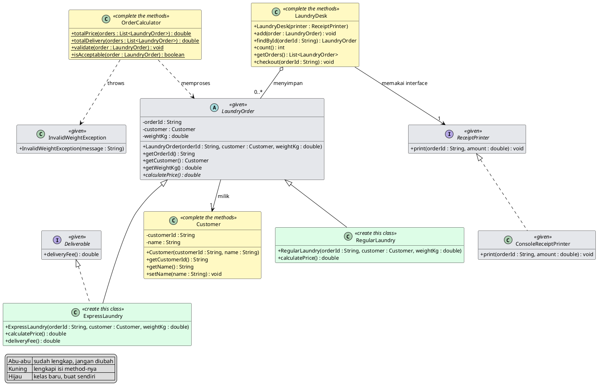
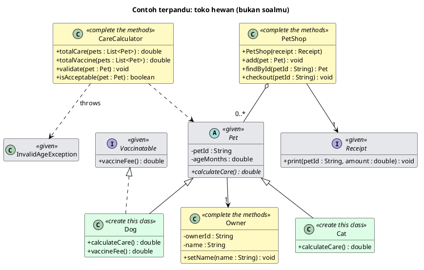

# Kuis Praktik 2 OOP: Laundry Kiloan

🇬🇧 English version: [README.md](README.md)

Waktu pengerjaan: **120 menit**. Nilai maksimal: **100 poin**, dinilai otomatis setiap kamu melakukan push.

## Studi Kasus

Kamu membangun inti aplikasi **Laundry Kiloan**. Setiap pesanan laundry punya jenis (**laundry reguler** dan **laundry ekspres**), dan tiap jenis menghitung harga dengan aturannya sendiri. Hanya satu jenis yang punya layanan antar-jemput. Sebuah pesanan laundry hanya valid bila berat lebih dari 0 dan paling banyak 20 kg. Semua pesanan laundry disimpan di **meja laundry**, lalu dibayar lewat **pencetak struk**.

Kuis ini mencakup materi **Pertemuan 9 sampai 11**: kelas abstrak dan interface, polimorfisme dan `instanceof`, exception, `ArrayList` dan `Map`, serta prinsip SOLID.

## Cara Kerja Kuis Ini

Kuis dibagi menjadi **lima tahap yang makin sulit**. Urutannya mengikuti urutan kuliah, jadi kerjakan dari tahap 1.

| Tahap | Isi | Poin |
|---|---|---:|
| 1 | Pemanasan: class dan enkapsulasi | 15 |
| 2 | Kelas abstrak dan interface (Pertemuan 9) | 20 |
| 3 | Polimorfisme dan exception (Pertemuan 10) | 20 |
| 4 | Collections (Pertemuan 11) | 15 |
| 5 | SOLID (Pertemuan 11) | 30 |

- **Tahap 1 sampai 3 bernilai 55 poin.** Bila kamu menyelesaikan ketiganya, kamu sudah lulus dengan nyaman.
- **Tiap tahap berdiri sendiri.** Tes tahap 3 sampai 5 memakai kelas buatan tes, bukan kelas buatanmu. Bila kamu macet di satu tahap, lanjutkan ke tahap berikutnya: poinnya tetap bisa kamu dapat.
- **Semua tes terlihat.** Buka folder `src/test` untuk membaca apa yang diperiksa. Kamu boleh membacanya, tetapi tidak boleh mengubahnya.
- **Tes yang gagal memberi petunjuk.** Pesan gagal menyebut aturan yang dilanggar.

## Diagram Kelas

Diagram kelas adalah **spesifikasi utama**. Semua nama kelas, field, constructor, dan method yang kamu butuhkan ada di sana.



Warna menunjukkan apa yang harus kamu lakukan:

| Warna | Artinya |
|---|---|
| Abu-abu (given) | Sudah lengkap, jangan diubah. |
| Kuning (complete the methods) | Kelasnya sudah ada. Lengkapi isi method-nya. |
| Hijau (create this class) | Kelasnya belum ada. Buat sendiri. |

## Aturan Bisnis

| Hal | Aturan |
|---|---|
| laundry reguler (`RegularLaundry`) | harga = berat x Rp 6.000 per kg |
| laundry ekspres (`ExpressLaundry`) | harga = berat x Rp 9.000 per kg. Punya layanan antar-jemput (`Deliverable`) dengan biaya tetap Rp 5.000. |
| laundry reguler | Tidak punya layanan antar-jemput. |
| berat tidak valid | Valid hanya bila berat lebih dari 0 dan paling banyak 20 kg. Di luar itu, lempar exception dengan pesan `Invalid weight: ` diikuti nilainya, contoh `Invalid weight: 25.0`. |
| Checkout | meja laundry meminta pencetak struk mencetak kode dan harga. |

Gunakan tipe `double` untuk berat, harga, dan biaya.

## Contoh Terpandu: Toko Hewan

Sebelum mulai, lihat satu contoh yang sudah dibahas: **toko hewan** (soal yang berbeda dari soalmu). Diagramnya punya bentuk yang sama dengan soalmu.



Contoh ini dikerjakan tahap demi tahap. Perhatikan polanya, lalu terapkan pada Laundry Kiloan.

| Tahap | Di toko hewan | Di Laundry Kiloan |
|---|---|---|
| 1 | `Owner`: simpan nama pemilik, tolak nama kosong. | `Customer`: simpan nama pelanggan, tolak nama kosong. |
| 2 | `Cat` dan `Dog` mewarisi `Pet`. Hanya `Dog` yang mengimplementasikan `Vaccinatable`. | `RegularLaundry` dan `ExpressLaundry` mewarisi `LaundryOrder`. Hanya `ExpressLaundry` yang mengimplementasikan `Deliverable`. |
| 3 | `CareCalculator` menjumlahkan biaya perawatan semua hewan dalam satu looping, memeriksa vaksin dengan `instanceof Vaccinatable`, dan menolak hewan yang usianya tidak valid dengan `InvalidAgeException`. | `OrderCalculator` melakukan hal yang sama untuk pesanan laundry. |
| 4 | `PetShop` menyimpan hewan di `List` dan mencarinya lewat kode dengan `Map`. | `LaundryDesk` melakukan hal yang sama untuk pesanan laundry. |
| 5 | `PetShop` menerima `Receipt` dari luar lewat constructor. Tidak membuat pencetak sendiri, dan tidak mencetak sendiri. Jenis hewan baru langsung bekerja tanpa mengubah `PetShop`. | `LaundryDesk` menerima `ReceiptPrinter` dari luar. Jenis pesanan laundry baru langsung bekerja tanpa mengubah `LaundryDesk`. |

## Tahap 1: Pemanasan (15 poin)

**Tujuan:** melengkapi `Customer` agar menyimpan data dan menjaga nama tetap valid.

**Yang kamu kerjakan:**

1. Deklarasikan field untuk kode dan nama. Semua field `private`.
2. Isi constructor dan kedua getter.
3. Isi `setName`: nama `null`, kosong, atau hanya berisi spasi diabaikan, dan nama lama tetap.

<details>
<summary>Petunjuk</summary>

Field dituliskan di bagian atas kelas, masing-masing diawali `private`. Di constructor, nilai parameter dipindahkan ke field dengan kata `this`. Untuk nama yang hanya berisi spasi, ingat bahwa `String` punya method untuk membuang spasi di ujung dan method untuk memeriksa apakah isinya kosong.
</details>

**Cara menguji:** `mvn test -Dtest="CustomerConstructorGetterTest,CustomerEncapsulationTest"`

## Tahap 2: Kelas Abstrak dan Interface (20 poin)

**Tujuan:** membuat dua subclass dari `LaundryOrder`, dan memberi kemampuan tambahan hanya pada salah satunya.

**Yang kamu kerjakan:**

1. Buat kelas **`RegularLaundry`** yang `extends LaundryOrder`. Constructor menerima tiga parameter seperti di diagram dan meneruskannya ke `super`. Isi `calculatePrice()`: berat x Rp 6.000 per kg.
2. Buat kelas **`ExpressLaundry`** yang `extends LaundryOrder` dan `implements Deliverable`. Isi `calculatePrice()`: berat x Rp 9.000 per kg. Isi `deliveryFee()`: Rp 5.000.
3. `RegularLaundry` **tidak** boleh mengimplementasikan `Deliverable`.

<details>
<summary>Petunjuk</summary>

Kelas baru dibuat di folder yang sama dengan kelas lain. Constructor subclass menerima tiga parameter seperti constructor kelas abstrak, lalu memanggil `super` di baris pertamanya. Tanda `@Override` membantu compiler memastikan kamu benar-benar mengisi method abstrak. Interface dipakai dengan kata `implements`, dan kelas yang memakainya wajib mengisi semua method interface itu.
</details>

**Cara menguji:** `mvn test -Dtest="SubclassStructureTest,RegularLaundryPriceTest,ExpressLaundryPriceTest,AbilityInterfaceTest,AbstractAndInterfaceRulesTest"`

## Tahap 3: Polimorfisme dan Exception (20 poin)

**Tujuan:** melengkapi `OrderCalculator` agar memproses banyak pesanan laundry lewat tipe `LaundryOrder`, dan menolak data yang tidak valid dengan exception.

**Yang kamu kerjakan:**

1. `totalPrice`: jumlahkan harga semua pesanan laundry dalam satu looping. Daftar kosong menghasilkan 0.
2. `totalDelivery`: jumlahkan biaya antar-jemput dari pesanan laundry yang punya kemampuan itu. Periksa dengan `instanceof Deliverable`, bukan dengan nama subclass.
3. `validate`: lempar `InvalidWeightException` bila berat tidak valid, dengan pesan `Invalid weight: ` diikuti nilainya.
4. `isAcceptable`: panggil `validate` di dalam `try`/`catch`. Kembalikan `true` bila valid dan `false` bila exception terlempar.

<details>
<summary>Petunjuk</summary>

Satu looping cukup. Di dalamnya, panggil method yang sama pada tiap objek, dan biarkan tiap objek menjawab dengan aturannya sendiri: itulah polimorfisme. Untuk kemampuan tambahan, tanyakan apakah objeknya `Deliverable` (bukan apakah objeknya `ExpressLaundry`), supaya jenis lain yang punya kemampuan sama ikut terhitung. Method `validate` memakai `throw` untuk melempar exception baru. Method `isAcceptable` menangkapnya dengan `catch` lalu mengembalikan nilai boolean, jadi exception tidak keluar dari method itu.
</details>

**Cara menguji:** `mvn test -Dtest="TotalPriceTest,TotalAbilityTest,ValidateTest,IsAcceptableTest"`

## Tahap 4: Collections (15 poin)

**Tujuan:** melengkapi `LaundryDesk` agar menyimpan pesanan laundry dan mencarinya dengan cepat.

**Yang kamu kerjakan:**

1. Isi constructor: simpan pencetak struk yang diberikan, dan siapkan koleksi yang kosong.
2. `add`: simpan pesanan laundry di `List` **dan** di `Map` (kuncinya kode pesanan laundry).
3. `findById`: cari lewat `Map`. Bila kodenya tidak ada, kembalikan `null`.
4. `count` dan `getOrders`: jumlah dan daftar menurut urutan penambahan.

Jangan memakai array.

<details>
<summary>Petunjuk</summary>

Dua koleksi bekerja berdampingan: `List` mengingat urutan, `Map` mencari lewat kunci. Method `add` mengisi keduanya. `Map` mengembalikan `null` untuk kunci yang tidak ada, jadi `findById` tidak perlu looping sama sekali. Semua field dibuat `private`.
</details>

**Cara menguji:** `mvn test -Dtest="DeskAddCountTest,DeskFindByIdTest,DeskFindMissingTest,DeskOrderTest,DeskCollectionsTest"`

## Tahap 5: SOLID (30 poin)

**Tujuan:** menerapkan prinsip SOLID pada `LaundryDesk` lewat satu method, `checkout`.

**Yang kamu kerjakan:**

1. Simpan pencetak struk dari constructor di field bertipe **interface** `ReceiptPrinter`.
2. `checkout`: cari pesanan laundry lewat kodenya, lalu minta pencetak struk itu mencetak kode dan harga-nya. Bila kodenya tidak ada, tidak melakukan apa-apa.
3. `LaundryDesk` **tidak** mencetak apa pun sendiri, dan **tidak** membuat `ConsoleReceiptPrinter` di dalam dirinya.
4. Jangan mengecek nama subclass. Jenis pesanan laundry baru harus langsung bekerja tanpa mengubah `LaundryDesk` maupun `OrderCalculator`.

Tes tahap ini membuat jenis pesanan laundry baru **di dalam tes** untuk membuktikan kodemu tidak perlu diubah.

| Prinsip | Cara tes memeriksanya |
|---|---|
| Dependency Inversion (DIP) | `LaundryDesk` memegang `ReceiptPrinter` (interface), bukan kelas konkretnya. Objek pencetak palsu dari tes harus menerima panggilan. |
| Single Responsibility (SRP) | `LaundryDesk` tidak memakai `System.out`. Tugas mencetak milik pencetak struk. |
| Open/Closed (OCP) | Jenis baru buatan tes diterima dan dihitung tanpa perubahan apa pun pada kodemu. |
| Liskov Substitution (LSP) | Semua subclass `LaundryOrder`, termasuk yang harga-nya 0, diperlakukan sama. |

<details>
<summary>Petunjuk</summary>

Constructor menerima objek bertipe interface dan menyimpannya di field bertipe interface. Di `checkout`, cukup cari pesanan laundry lalu serahkan kode dan harga-nya ke pencetak. Kamu tidak perlu tahu pencetaknya mencetak ke layar, ke berkas, atau ke tempat lain: itu urusan pencetaknya. Untuk harga, panggil `calculatePrice()` pada objeknya, apa pun jenisnya.
</details>

**Cara menguji:** `mvn test -Dtest="DeskInterfaceTest,CheckoutUsesPrinterTest,DeskPrintsNothingTest,NewSubclassNoChangeTest,SubstitutionTest,NoConcretePrinterTest"`

## Mencoba Secara Manual

`Main.java` adalah tempat bebas untuk mencoba programmu (tidak dinilai). Setelah tahap 2 sampai 5 selesai, kamu bisa menulis percobaan di sana. Sebagai pegangan, hasil yang benar untuk 5 kg:

- laundry reguler: harga `30000.0`.
- laundry ekspres: harga `45000.0` dan biaya antar-jemput `5000.0`.
- Jumlah harga keduanya: `75000.0`.
- Checkout pesanan laundry bernomor `L1` (laundry reguler) menghasilkan baris: `Receipt L1: Rp 30000.0`.

Jalankan lewat NetBeans (**Run Project**), VS Code (**Run** di atas `main`), atau terminal:

```bash
mvn -q compile exec:java
```

## Memulai

Repositori ini adalah **template**:

1. Klik tombol hijau **Use this template**, lalu **Create a new repository**. Atur visibilitas menjadi **Private**, dan beri nama, misalnya `oop-quiz2-laundry-<nama-kamu>`.
2. Clone repositori **milikmu**:
   ```bash
   git clone git@github.com:<username-kamu>/oop-quiz2-laundry-<nama-kamu>.git
   ```
3. Buka proyek di editor, kerjakan tahap demi tahap, lalu commit dan push.
4. Setiap push menjalankan autograder. Buka tab **Actions** di repositorimu untuk melihat skormu. Bila GitHub meminta mengaktifkan workflow, klik **I understand my workflows, enable them**.

## Membuka Proyek

Ini proyek Maven biasa, tanpa konfigurasi tambahan.

**NetBeans**
1. **File, Open Project...**
2. Pilih folder `oop-quiz2-laundry-...` (NetBeans mengenalinya sebagai proyek Maven), lalu **Open Project**.
3. Klik kanan proyek, lalu **Test** untuk menjalankan semua tes. Satu tes dijalankan dari node `Test Packages`.

**Visual Studio Code**
1. Pasang **Extension Pack for Java** (Microsoft).
2. **File, Open Folder...** lalu pilih folder hasil clone.
3. Jalankan tes dari sidebar **Testing** (ikon labu), atau lewat terminal: `mvn test`.

## Membaca Hasil Tes

Jalankan `mvn test` di terminal, atau lihat tab **Actions**. Tiap tes yang gagal menulis satu kalimat yang menyebut **aturan yang dilanggar**. Perbaiki satu kelompok tes pada satu waktu, lalu jalankan kelompok itu lagi. Bila muncul error `Not implemented yet`, method itu masih kosong.

## Penilaian

Total **100 poin**, terbagi dalam 22 kelompok tes. Sebuah kelompok mendapat poinnya bila semua tes di dalamnya lulus. Jalankan semuanya dengan `mvn test`, atau satu kelompok dengan `mvn test -Dtest=NamaKelasTes`.

| # | Kelompok tes | Tahap | Poin |
|---|---|---|---:|
| 1 | Customer Constructor and Getter Test | 1 | 5 |
| 2 | Customer Encapsulation Test | 1 | 10 |
| 3 | Subclass Structure Test | 2 | 4 |
| 4 | RegularLaundry Price Test | 2 | 4 |
| 5 | ExpressLaundry Price Test | 2 | 4 |
| 6 | Deliverable Interface Test | 2 | 4 |
| 7 | Abstract Class and Interface Rules Test | 2 | 4 |
| 8 | OrderCalculator Total Price (Polymorphism) Test | 3 | 5 |
| 9 | OrderCalculator Deliverable Total (instanceof) Test | 3 | 5 |
| 10 | OrderCalculator Validate (Exception) Test | 3 | 5 |
| 11 | OrderCalculator isAcceptable (try/catch) Test | 3 | 5 |
| 12 | LaundryDesk Add and Count Test | 4 | 3 |
| 13 | LaundryDesk Find By Id Test | 4 | 3 |
| 14 | LaundryDesk Find Missing Returns Null Test | 4 | 3 |
| 15 | LaundryDesk Keeps Insertion Order Test | 4 | 3 |
| 16 | LaundryDesk Uses List and Map Test | 4 | 3 |
| 17 | LaundryDesk Depends on ReceiptPrinter Interface Test (DIP) | 5 | 5 |
| 18 | Checkout Uses Injected ReceiptPrinter Test (DIP) | 5 | 7 |
| 19 | LaundryDesk Prints Nothing Itself Test (SRP) | 5 | 4 |
| 20 | New Subclass Needs No Change Test (OCP) | 5 | 8 |
| 21 | Any Subclass Substitutes Test (LSP) | 5 | 3 |
| 22 | No Concrete ReceiptPrinter Inside LaundryDesk Test (DIP) | 5 | 3 |
| | **Total** | | **100** |

## Aturan

- **Jangan mengubah** berkas di `src/test/**` dan `.github/**`.
- Ikuti diagram kelas persis: nama kelas, field, method, dan signature dipakai oleh autograder.
- Semua field harus `private`.
- Di `LaundryDesk`, pakai `List` dan `Map`. Jangan memakai array.
- Kelas abu-abu sudah lengkap dan tidak boleh diubah.
- Kerjakan sendiri. Repositori yang mirip akan diperiksa.
